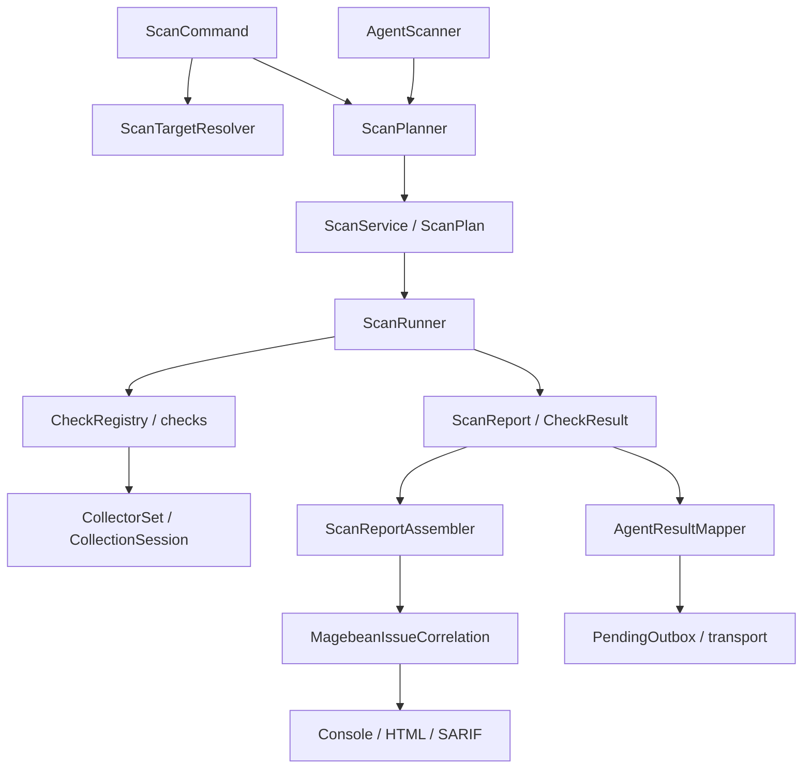

# Architecture

The primary runtime assesses one stable internal MB identity per definition, with reusable checks and explicit evidence obligations. Magebean, ASVS and PCI are separate source families. Historical MB-R selectors remain compatibility adapters. See [requirement model](requirement-model.md) and [source families](requirement-source-families.md).

## Selection and collection

The console adapter resolves targets, options and preflight. Local runtime URL discovery uses Magento store configuration through a shared resolver. ScanPlanner compiles project policy, profile IDs/default capabilities, explicit selectors, target modes, exclusions and human evidence gates. RulesListCommand queries the same profile context resolution. Agent manifests retain explicit context and do not inherit CLI defaults from a profile label.

CheckRegistry binds passive collectors for one invocation. CollectionSession bounds in-memory observations and caches successful reusable results only within that session. DependencyInventory distinguishes installed metadata, locked-only and dev scope. Module inventory, literal configuration and supported PHP/XML analysis retain provenance, limits and uncertainty. Literal configuration and module analysis are parsed passively. Legacy dynamic evaluation fallbacks retain their caller behavior; these collectors are not a general PHP sandbox.

## Assessment and presentation

RequirementEvaluator evaluates mandatory/supporting obligations and accepted alternatives. Raw per-rule outcomes remain inspectable. MagebeanRiskObservation retains observed issues alongside independent collection gaps. MagebeanFindingSemantics separates security/correctness/policy/informational meaning and condition confidence from exploitability.

MagebeanIssueCorrelation groups only verified shared evidence identities. Original assessments, contributors, dependency scope and complementary observations remain. Assembled CLI summary counts canonical issues; agent schema 1.0 keeps per-request outcomes and historical correspondence, with additive canonical references. Console persistence remains per assessment item.

Collection-only errors are diagnostics, not ordinary security findings. ScanExitPolicy retains incomplete native execution as exit code 3 before severity-based codes. Source findings and declaration checks do not certify effective runtime configuration, full flows or overall safety.

## Compatibility and operation

[Contracts](scan-contracts.md), [planning](scan-planning.md), [collectors](scan-collectors.md), [reliability](scan-reliability.md) and [reporting](../guides/findings-and-output.md) describe boundaries. Tests exercise source and packaged engines; [release packaging](release-packaging.md) qualifies runtime-only candidates. Historical architecture plans, migration decisions and QA evidence are indexed under [archive](../archive/README.md).
